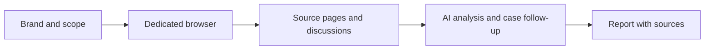

<p align="center"></p>

<p align="center"><strong>Your AI assistant, equipped for brand monitoring.</strong><br>Search public conversations, understand emerging issues, and follow cases through to their next development.</p>

<p align="center"><a href="README.zh-CN.md">简体中文</a> · <a href="docs/INSTALL.md">Get started</a> · <a href="docs/BROWSER.md">Browser & login</a> · <a href="docs/WORKFLOW.md">How it works</a></p>

<p align="center"><a href="https://github.com/miyahluvgames-source/brand-reputation-monitor-skill/actions/workflows/ci.yml"></a>  <a href="LICENSE"></a></p>

## From scattered conversations to an actionable brief

Brand Reputation Monitor is an installable AI skill for researching how a brand, product or service is being discussed. It brings together a dedicated browser, a repeatable research workflow, and tools for organizing the results.

Tell your assistant what to monitor. It searches the web and selected social platforms, reads source pages, groups related discussion, and produces a brief with relevant developments, source links and suggested follow-up. On later runs, it revisits open cases so the report can explain what changed.

| Use it for | The result |
| --- | --- |
| Everyday brand monitoring | A concise view of emerging feedback, recurring topics and issues needing attention |
| Product launches and campaigns | Themes in public reactions, common questions and friction points |
| Service changes and incidents | A view of reported impact and developments after an announcement or recovery |
| Complaint follow-up | A continuing case history with new evidence, current status and the next check |

## Start with one installation

You need **Python 3.10+** and an AI assistant that can load skills and run local commands, such as Codex. Download or clone this repository, then run:

```sh
python3 scripts/install_skill.py
```

The default installer copies the complete skill, creates its isolated Python environment, and installs Playwright. It uses an existing Google Chrome application with a separate monitoring profile when available; otherwise, it downloads Chromium. Setup checks that the selected browser can start. It does not require you to install a separate browser plugin or provide a model API key to this project. Your assistant supplies the language model.

Then start a new conversation with your assistant:

```text
Use $brand-reputation-monitor to set up monitoring for Fable Labs.
Search the web, X and Reddit for feedback from the last 72 hours.
Guide me through any required platform login, then give me a report
with the main developments, original sources and suggested next steps.
```

The assistant checks the installation and prepares the sources needed for your request. **For account-based platforms, it opens a dedicated monitoring browser and guides you through signing in.** Enter your password and verification code in that browser yourself, close the window when finished, and let the assistant check access. You can skip login and begin with public web sources.

See [installation](docs/INSTALL.md) for Windows commands, manual skill installation, updates and setup recovery.

## A browser just for monitoring

The skill includes a Playwright browser channel with its own persistent profile. It can use Google Chrome or the bundled Chromium runtime. It keeps monitoring sessions separate from your everyday browser and reuses their local login state between runs.

| First use | Later use |
| --- | --- |
| The installer prepares a dedicated browser environment | The assistant checks that the runtime is available |
| The assistant opens a visible window for the platforms you choose | Collection reuses the same monitoring profile |
| You complete login and any verification steps | If a session expires, the assistant guides you through login again |
| The assistant verifies access from the rendered page | Browser processes close after each command; the profile is kept |

The browser never imports your personal browser profile. Login data stays in the local monitoring profile; it is not included in reports. [Browser commands and data locations →](docs/BROWSER.md)

## How it works



**The skill directs the research.** It turns your request into a source plan, searches for relevant discussion, follows original pages and revisits existing cases.

**The browser gathers the material.** The bundled channel supports web, X and Reddit search, page reading, and login guidance. It returns rendered text, links and available page timestamps. If your assistant already has an approved search or browser integration, the skill can use that channel as well.

**Your assistant interprets it.** The host model groups related claims, reads context, assesses significance and explains changes. This goes beyond assigning a positive or negative label to individual keywords.

**The local tools organize the output.** JSON coverage records and Markdown reports give you a consistent way to store sources, topics and case checks. The [record format](docs/SCHEMA.md) is documented for your own integrations.

## What a report contains

- **Overview:** the monitoring window and the developments that deserve attention.
- **Key findings:** a summary of each issue, source links, timing and supporting evidence.
- **Case follow-up:** what is new, what changed, and which questions remain open.
- **Recommended action:** what to investigate or pass to the relevant team.
- **Source coverage:** where the assistant searched and which sources it could not access.

You can also ask the assistant to review a saved evidence bundle without collecting fresh material. The [fictional example report](examples/partial-report.md) demonstrates the companion tool's structured output; the assistant adds the narrative assessment.

## Explore the project

| Path | Purpose |
| --- | --- |
| [`skill/`](skill/) | Installable instructions, browser/setup scripts and focused references |
| [`reputation_monitor/`](reputation_monitor/) | Coverage validation and Markdown report CLI |
| [`examples/`](examples/) | Fictional plan, observations and generated report |
| [`docs/`](docs/) | Installation, browser, workflow and record-format guides |
| [`tests/`](tests/) | Regression tests for the tools and installation |

To try the local report tools from this checkout:

```sh
python3 -m reputation_monitor check --plan examples/watch-plan.json --record examples/partial-run.json
python3 -m reputation_monitor report --plan examples/watch-plan.json --record examples/partial-run.json
```

To run the tests:

```sh
python3 -m unittest discover -s tests -v
```

## Practical limits

Platform access depends on your account, local network and each site's current restrictions. Login or a successful installation does not guarantee that every page is accessible. Reports link to their sources and identify missing coverage. The skill researches and reports; recurring schedules and notification delivery use your assistant's separately configured automation tools.

[MIT](LICENSE) · [Contributing](CONTRIBUTING.md) · [Security](SECURITY.md) · [Changes](CHANGELOG.md)
