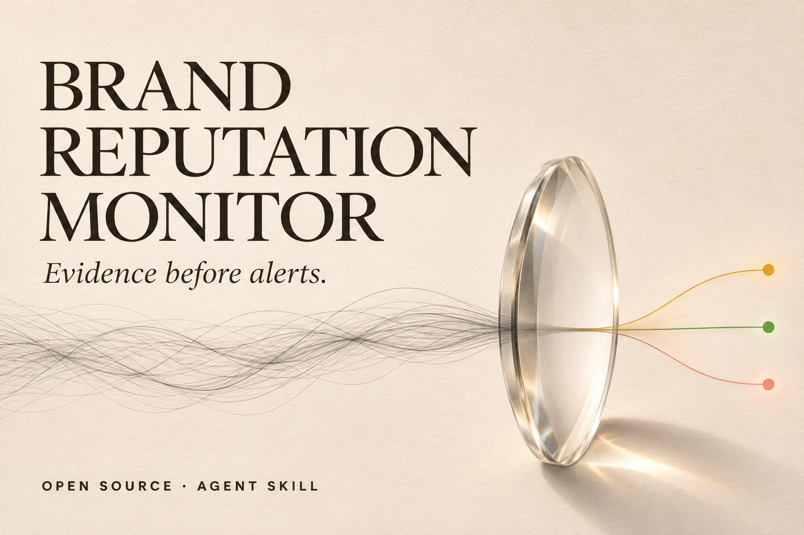
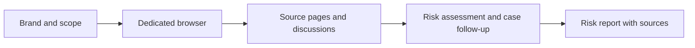

<p align="center"></p>

<p align="center"><strong>A skill for monitoring brand reputation risks.</strong><br>Find complaints and criticism, check the evidence, and follow developing issues.</p>

<p align="center"><a href="README.zh-CN.md">简体中文</a> · <a href="docs/INSTALL.md">Get started</a> · <a href="docs/BROWSER.md">Browser & login</a> · <a href="docs/WORKFLOW.md">How it works</a></p>

<p align="center"><a href="https://github.com/miyahluvgames-source/brand-reputation-monitor-skill/actions/workflows/ci.yml"></a>  <a href="LICENSE"></a></p>

## Find potential risks to your brand's reputation

Brand Reputation Monitor is an AI skill that helps brands find and investigate potential reputation risks. It uses a dedicated browser to search the web, X and Reddit for customer complaints, negative reviews and disputed claims about a brand, product or service.

Give your assistant a brand name, platforms and time range. It checks original sources, groups repeated mentions, and identifies issues that need attention, with the evidence behind its assessment and questions still unresolved. On later runs, it checks existing cases for new complaints, responses and reported progress so you can decide what needs further investigation or action.

| Use it for | What to look for |
| --- | --- |
| Everyday brand monitoring | New complaints, recurring criticism and negative claims that need checking |
| Product launches and campaigns | Complaints about the product experience, marketing claims or campaign rules |
| Service changes and incidents | Reported impact, criticism of official responses and complaints that remain unresolved after recovery |
| Ongoing issues | New complaints, responses and reported progress, with resurfaced content distinguished from new events |

## Start with one installation

You need **Python 3.10+** and an AI assistant that can load skills and run local commands, such as Codex. Download or clone this repository, then run:

```sh
python3 scripts/install_skill.py
```

The default installer copies the complete skill, creates its isolated Python environment, and installs Playwright. It uses an existing Google Chrome application with a separate monitoring profile when available; otherwise, it downloads Chromium. Setup checks that the selected browser can start. It does not require you to install a separate browser plugin or provide a model API key to this project. Your assistant supplies the language model.

Then start a new conversation with your assistant:

```text
Use $brand-reputation-monitor to set up monitoring for Fable Labs.
Check the web, X and Reddit for complaints, criticism and negative
claims from the last 72 hours that could affect the brand's reputation.
Guide me through any required platform login. Report the risks that
need attention, original sources, reasons for concern and next steps.
```

The assistant checks the installation and prepares the sources needed for your request. **For account-based platforms, it opens a dedicated monitoring browser and guides you through signing in.** Enter your password and verification code in that browser yourself, close the window when finished, and let the assistant check access. You can skip login and begin with public web sources.

See [installation](docs/INSTALL.md) for Windows commands, manual skill installation, updates and setup recovery.

## A browser just for monitoring

The skill includes a Playwright browser channel with its own persistent profile. It can use Google Chrome or the bundled Chromium runtime. It keeps monitoring sessions separate from your everyday browser and reuses their local login state between runs.

| First use | Later use |
| --- | --- |
| The installer prepares a dedicated browser environment | The assistant checks that the runtime is available |
| The assistant opens a visible window for the platforms you choose | Collection reuses the same monitoring profile |
| You complete login and any verification steps | If a session expires, the assistant guides you through login again |
| The assistant verifies access from the rendered page | Browser processes close after each command; the profile is kept |

The browser never imports your personal browser profile. Login data stays in the local monitoring profile; it is not included in reports. [Browser commands and data locations →](docs/BROWSER.md)

## How it works



**The skill directs the research.** It turns your request into a source plan, searches for relevant discussion, follows original pages and revisits existing cases.

**The browser gathers the material.** The bundled channel supports web, X and Reddit search, page reading, and login guidance. It returns rendered text, links and available page timestamps. If your assistant already has an approved search or browser integration, the skill can use that channel as well.

**Your assistant assesses the risks.** It reads complaints and criticism in context, explains why an issue could affect the brand's reputation, and checks what has changed. It gives reasons for its assessment and distinguishes verified information from claims that still need checking.

**The local tools organize the output.** JSON coverage records and Markdown reports give you a consistent way to store sources, topics and case checks. The [record format](docs/SCHEMA.md) is documented for your own integrations.

## What a report contains

- **Risk overview:** potential risks, which issues need attention first, and why.
- **Original evidence:** the complaints or disputed claims, source links, timing, and what is verified or still uncertain.
- **Case follow-up:** new complaints, responses, reported progress and changes since the previous run.
- **Next steps:** facts to check and issues to pass to support, product or communications teams.
- **Source coverage:** where the assistant searched and which sources it could not access.

You can also ask the assistant to review a saved evidence bundle without collecting fresh material. The [fictional example report](examples/partial-report.md) demonstrates the companion tool's structured output; the assistant adds the narrative assessment.

## Explore the project

| Path | Purpose |
| --- | --- |
| [`skill/`](skill/) | Installable instructions, browser/setup scripts and focused references |
| [`reputation_monitor/`](reputation_monitor/) | Coverage validation and Markdown report CLI |
| [`examples/`](examples/) | Fictional plan, observations and generated report |
| [`docs/`](docs/) | Installation, browser, workflow and record-format guides |
| [`tests/`](tests/) | Regression tests for the tools and installation |

To try the local report tools from this checkout:

```sh
python3 -m reputation_monitor check --plan examples/watch-plan.json --record examples/partial-run.json
python3 -m reputation_monitor report --plan examples/watch-plan.json --record examples/partial-run.json
```

To run the tests:

```sh
python3 -m unittest discover -s tests -v
```

## Practical limits

Platform access depends on your account, local network and each site's current restrictions. Login or a successful installation does not guarantee that every page is accessible. Reports link to their sources and identify missing coverage. The skill researches and reports; recurring schedules and notification delivery use your assistant's separately configured automation tools.

[MIT](LICENSE) · [Contributing](CONTRIBUTING.md) · [Security](SECURITY.md) · [Changes](CHANGELOG.md)
