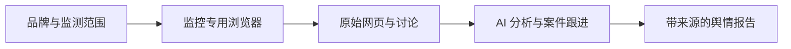

<p align="center"></p>

<p align="center"><strong>让 AI 助手成为你的品牌舆情研究员。</strong><br>从公开讨论中发现反馈、理解问题，并持续跟进事件进展。</p>

<p align="center"><a href="README.md">English</a> · <a href="docs/INSTALL.zh-CN.md">开始使用</a> · <a href="docs/BROWSER.zh-CN.md">浏览器与登录</a> · <a href="docs/WORKFLOW.md">工作原理</a></p>

## 把分散的讨论，整理成可行动的舆情简报

Brand Reputation Monitor 是一个可以安装到 AI 助手中的舆情监测技能，适合关注品牌、产品和服务的公开反馈。它把监控专用浏览器、舆情研究流程和报告工具组合在一起，让助手能够完成从查找信息到形成结论的工作。

告诉助手要关注什么，它会搜索网页和指定社交平台、阅读原始内容、归纳相关讨论，并给出主要发现、来源链接和后续建议。再次监测时，它还会回看已有案件，说明哪些问题出现了新进展。

| 应用场景 | 你会得到什么 |
| --- | --- |
| 日常品牌巡检 | 新出现的反馈、反复被提及的话题、需要关注的问题 |
| 新品发布与活动复盘 | 公开讨论中的主要反应、常见疑问和使用痛点 |
| 服务变更与故障观察 | 公告发布、服务调整或恢复之后的用户反馈和事件进展 |
| 投诉持续跟进 | 带来源的案件记录，以及本次变化、当前状态和后续核查方向 |

## 安装后，直接告诉助手你要监控什么

需要 **Python 3.10+**，以及能够加载 Skill、执行本地命令的 AI 助手，例如 Codex。下载或克隆本仓库后，在项目目录运行：

```sh
python3 scripts/install_skill.py
```

默认安装器会复制完整技能、创建隔离的 Python 运行环境并安装 Playwright。优先使用电脑已安装的 Google Chrome 程序，为它建立独立的监控配置；没有 Chrome 时，再下载 Chromium。配置过程中会检查选定浏览器能否启动。你无需另外寻找浏览器插件，也不需要为本项目单独配置模型 API Key；分析能力由当前 AI 助手提供。

然后在新的助手对话中输入：

```text
使用 $brand-reputation-monitor，为 Fable Labs 设置舆情监测。
关注最近 72 小时的网页、X 和 Reddit 反馈。
如果需要平台登录，请引导我完成，然后给我一份包含主要发现、
原始来源和后续建议的报告。
```

助手会先检查安装状态，再准备这次任务需要的来源。**需要登录的平台，会打开监控专用浏览器并引导你登录。** 你在浏览器内亲自输入密码、完成验证码或二步验证，登录后关闭窗口，助手再检查访问状态。也可以先跳过登录，从公开网页开始。

Windows 命令、手动安装、更新与安装失败后的继续方法见[安装说明](docs/INSTALL.zh-CN.md)。

## 自带监控专用浏览器

技能内置 Playwright 浏览器通道，可以使用 Google Chrome 或配套 Chromium，并使用独立、持久化的监控配置目录。日常浏览和舆情采集各自使用自己的环境；监控账号的登录态会保存在本地，供后续任务复用。

| 首次使用 | 后续使用 |
| --- | --- |
| 安装器准备专用浏览器环境 | 助手检查运行环境是否可用 |
| 助手按你选择的平台打开可见窗口 | 采集复用同一个监控配置目录 |
| 你本人完成登录及平台验证 | 登录过期时，助手引导你重新登录 |
| 助手从页面核验访问状态 | 每次命令结束后退出浏览器进程，保留登录资料 |

它不会复制个人默认浏览器的资料。登录数据留在本地监控环境中，不进入报告。[查看浏览器命令与数据位置 →](docs/BROWSER.zh-CN.md)

## 原理与实现方式



**Skill 负责组织研究。** 将你的需求转为来源与搜索计划，阅读相关内容，并持续回看已有案件。

**浏览器负责获取材料。** 随技能提供的通道支持公开网页、X、Reddit 搜索，以及页面阅读和登录引导，返回页面渲染后的正文、链接和可取得的时间信息。如果助手已经有适用的搜索或浏览器集成，也可以使用已有通道。

**AI 助手负责理解语义。** 根据上下文归纳相关主张、判断事件重要性、比较前后变化，形成解释和建议，而不是只按关键词给帖子贴上正面或负面标签。

**本地工具负责整理记录。** 用 JSON 保存来源覆盖、话题和案件核查情况，并生成统一的 Markdown 报告。[记录格式](docs/SCHEMA.md)已公开，便于接入自己的工作流。

## 一份报告里有什么

- **整体概况**：观察时间范围，以及值得优先关注的变化。
- **主要发现**：每个问题的摘要、来源链接、发生时间和相关证据。
- **案件跟进**：新出现的情况、已有问题的进展、尚待确认的事项。
- **行动建议**：适合进一步调查或交给相关团队处理的内容。
- **来源覆盖**：本次检查了哪些来源，哪些来源暂时无法访问。

你也可以把已有材料交给助手，直接完成一次资料审阅。[虚构示例报告](examples/partial-report.md)展示了配套工具的结构化输出，助手会在此基础上给出文字分析。

## 项目组成

| 路径 | 用途 |
| --- | --- |
| [`skill/`](skill/) | 可安装技能、浏览器与配置脚本、按需参考 |
| [`reputation_monitor/`](reputation_monitor/) | 覆盖记录校验和 Markdown 报告 CLI |
| [`examples/`](examples/) | 虚构监测计划、观察记录和报告 |
| [`docs/`](docs/) | 安装、浏览器、工作流和记录格式说明 |
| [`tests/`](tests/) | 工具与安装流程的回归测试 |

在仓库中体验记录工具：

```sh
python3 -m reputation_monitor check --plan examples/watch-plan.json --record examples/partial-run.json
python3 -m reputation_monitor report --plan examples/watch-plan.json --record examples/partial-run.json
```

运行测试：

```sh
python3 -m unittest discover -s tests -v
```

## 使用范围

平台访问取决于账号、网络和网站当时的限制；完成安装与登录后，仍可能遇到无法访问的页面。报告会保留来源和缺失范围。技能负责研究与报告；定时执行和消息通知使用助手另行配置的自动化工具。

[MIT 许可](LICENSE) · [贡献指南](CONTRIBUTING.md) · [安全说明](SECURITY.md) · [更新记录](CHANGELOG.md)
